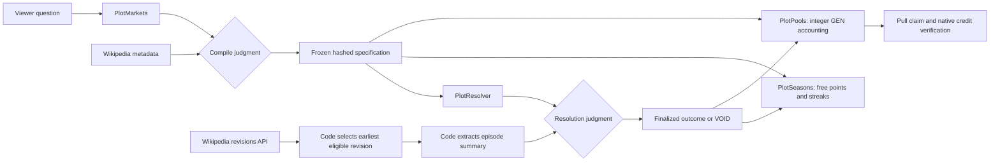

# Plot Armor

Bet on your favourite shows. GenLayer validators read the episode and settle it — spoiler-free.

**Release in progress.** See [deploy/proof.json](deploy/proof.json) and [docs/VERIFICATION.md](docs/VERIFICATION.md) for actual outcomes and remaining verification limits. Never interpret a successful HTTP response or ACCEPTED transaction as a successful settlement.

## Architecture



There are exactly two model judgments: compiling one question and resolving one episode proposition. The pool and leaderboard use no LLM. Each state-changing result becomes usable through a self callback emitted on finality. Compile validators independently retrieve the source and verify the entire frozen candidate. Resolver validators independently select/fetch/extract, compare the summary digest and chosen option, and check the leader's verbatim quote.

## Run locally

Use Node 24 and Python 3.14 with the pinned dependencies:

```sh
npm ci
python -m pip install -r requirements.txt
npm run dev
```

Browse port 3134. No environment secrets are needed to browse. Wallet signing happens through an EIP-1193 wallet connected to StudioNet, chain 61999. The Python release account is generated only in ignored `.secrets/demo-accounts.json`. Never publish that directory.

```sh
npm run lint:contract
npm run test:contract
npm run typecheck
npm run lint
npm test
npm run build
```

Direct mode supports one contract per process: the test script runs each contract test file in a fresh pytest process and stubs `gl.get_contract_at`. It does not emulate multi-validator consensus; real receipts are required in addition.

## Resumable release

```sh
python scripts/probe.py
npm run release -- deploy
npm run release -- seed
npm run release -- live
npm run settle
npm run release -- record
npm run verify:proof
```

Hashes persist before polling, and receipt polling uses ten-second intervals. Rerun a stage after interruption; do not blindly send another transaction. `settle` only tries eligible unresolved markets. It does not invent an outcome or send deposits. The first rehearsal compile failed with MAJORITY_DISAGREE; the previous release remains recorded separately in proof history. The repaired compile validator checks a candidate against independent evidence rather than requiring different LLMs to invent identical free-text specs. The final compiler requests ISO timestamps and converts them to Unix seconds in Python; Wikipedia requests use the same explicit browser user agent proven by the access probe.

## Pool accounting

Prepare a zero-value stake ticket, wait for finality, then deposit its exact amount before expiry. Invalid well-formed deposits create wallet refund credits. A finalized failed payable call that credited value can be recovered using its immutable protocol receipt. Code distributes the entire parimutuel pot with cumulative integer allocation, including remainder wei. VOID, empty winning sides and unresolved deadlines refund stakes. Claims emit a separate native transfer on finality. A pending claim cannot be repeated; only an explicitly failed native credit permits a retry. Unknown or delayed receipts never authorize a duplicate transfer.

## Spoiler shield

The initial server payload removes outcomes, evidence quotes, revision URLs and wallet payouts. A viewer must explicitly reveal a market to fetch its recorded outcome. CSS blurs neutral placeholder shapes; it does not merely hide readable spoiler text. Market refresh controls label live finalized reads separately from recorded proof. My predictions preserve the shield before personal scoring is revealed.

## Limitations

* Only English Wikipedia episode Plot/Synopsis sections or exact Episode list rows are supported. Unsupported or absent summaries stay retryable and ultimately refund.
* The earliest eligible revision is selected by code in ascending API order, five revisions per attempt. A cursor advances only after all previous candidates lack a usable summary. Once selected, a revision stays frozen, including when UNCLEAR.
* Wikipedia facts, schedule changes, delayed summaries, vandalism and model disagreement can prevent settlement. No administrator may choose a winner.
* Historical rehearsals are labeled, owner-only for GEN stakes, and excluded from competitive points. They use a short entry window after compilation to demonstrate the accounting lifecycle; this exception never applies to live forecasts.
* `genlayer-js` 1.1.8 uses StudioNet's legacy ABI and has no modern `fees` argument. The wallet adapter supplies explicit EVM gas price. Release calls use `genlayer-py==0.18.0` and explicit protocol fee budgets. A fee-policy change needs a reviewed adapter update.
* Native credits are asynchronous. Verification can remain pending if the protocol RPC is unavailable; funds are never claimed twice based on a timeout alone.
* Server read limits are per process, with caching and queued requests. They are a convenience throttle, not a distributed rate-limit guarantee across Vercel instances.
* The project is a StudioNet demonstration with simulated GEN, not a real-money service.

## Submission

[Portal fields](docs/submission/portal-fields.json) are a draft for the owner. The project never submits them. All explorer URLs come from `lib/explorer.ts`; the read-only verifier checks the explorer API's real CONTRACT and transaction records with a browser user agent.

See [the tutorial](docs/TUTORIAL.md), [two-minute demo](docs/DEMO.md), and [verification report](docs/VERIFICATION.md).
